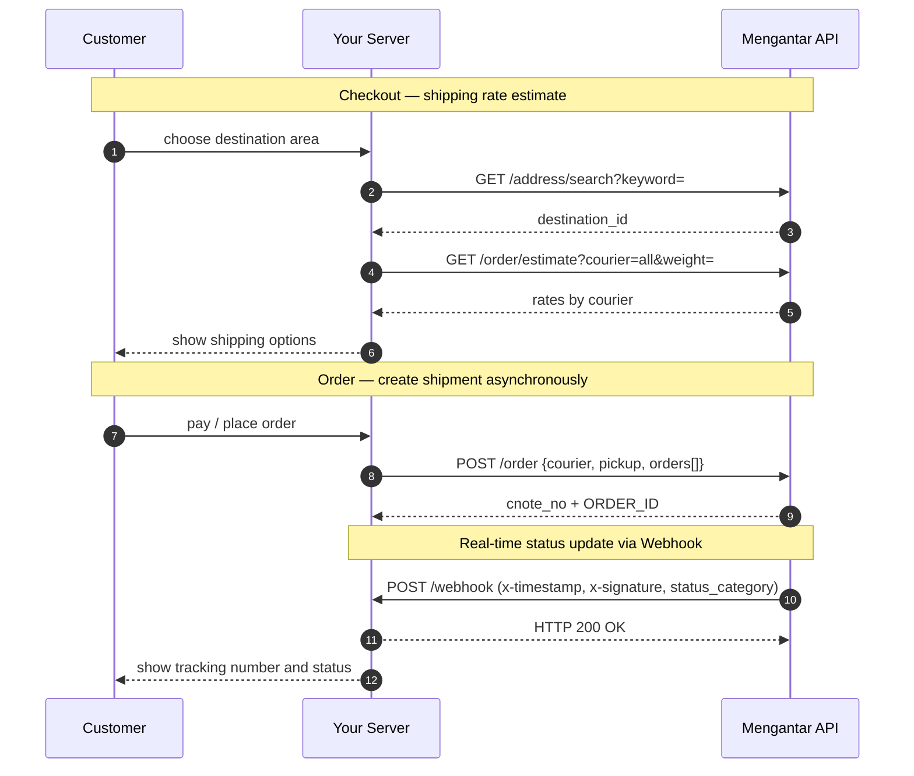

```text
  ███╗   ███╗███████╗███╗   ██╗ ██████╗  █████╗ ███╗   ██╗████████╗ █████╗ ██████╗ 
  ████╗ ████║██╔════╝████╗  ██║██╔════╝ ██╔══██╗████╗  ██║╚══██╔══╝██╔══██╗██╔══██╗
  ██╔████╔██║█████╗  ██╔██╗ ██║██║  ███╗███████║██╔██╗ ██║   ██║   ███████║██████╔╝
  ██║╚██╔╝██║██╔══╝  ██║╚██╗██║██║   ██║██╔══██║██║╚██╗██║   ██║   ██╔══██║██╔══██╗
  ██║ ╚═╝ ██║███████╗██║ ╚████║╚██████╔╝██║  ██║██║ ╚████║   ██║   ██║  ██║██║  ██║
  ╚═╝     ╚═╝╚══════╝╚═╝  ╚═══╝ ╚═════╝ ╚═╝  ╚═╝╚═╝  ╚═══╝   ╚═╝   ╚═╝  ╚═╝╚═╝  ╚═╝

                   M U L T I - C O U R I E R   A P I
                      B Y   O N G K I . P R O

     "Official Partner Reference & High-Speed Indonesian Logistics Engine"

       [▶ SPECS] OpenAPI 3.1  ·  [● ENDPOINTS] 24 Operations + Webhook  ·  [MIT LICENSE]
```

<p align="center">
  <a href="https://ongki.pro"></a>
  <a href="https://github.com/ongkipro/mengantar-documentation/actions/workflows/ci.yml"></a>
  <a href="./spec/openapi.yaml"></a>
  <a href="#endpoints-24-total--webhook"></a>
  <a href="https://ongki.pro"></a>
</p>

<p align="center">
  <a href="#architecture"><b>Architecture</b></a> ·
  <a href="#core-flow"><b>Core Flow</b></a> ·
  <a href="#endpoints-24-total--webhook"><b>Endpoints</b></a> ·
  <a href="#repository-layout"><b>Repository Layout</b></a> ·
  <a href="#documentation-index"><b>Docs Index</b></a> ·
  <a href="#quick-start-after-you-receive-an-api-key"><b>Quick Start</b></a>
</p>

---

## What this is

Mengantar.com is an Indonesian logistics aggregator: one API for multi-courier shipping rates, shipment creation, pickup scheduling, and tracking.

As an **Official Partner Mengantar**, [ongki.pro](https://ongki.pro) maintains this documentation to help teams integrate Mengantar into storefronts, headless commerce projects, and backend systems.

> **Verified:** endpoints, parameters, and response shapes here are matched against the official docs (`api-public.mengantar.com/docs`) and **verified live against the production API** (read-only, 2026-07-03; **re-verified 2026-07-19**; courier estimates re-checked **2026-09-25**). The official-docs audit covers all 24 endpoints, async PDF labels, dropshippers, Dangerous Goods, and HMAC-SHA256 Webhook support; write paths not exercised live are marked in [10-verification-checklist](docs/10-verification-checklist.md).
>
> ⚠️ **Courier Status (September 2026):** **Ninja** is discontinued effective 1 September 2026. **POS** is officially supported. **SPX (Shopee Express)** appears as `spx` in `estimate?courier=all` (live, 2026-09-25) and Mengantar support confirms `courier: "spx"` for create-order — not yet in the official docs and not yet observed in a live create-order. See [02 §1.2](docs/02-couriers-and-rules.md).

---

## Architecture

```mermaid
flowchart LR
    U["Customer"] -->|checkout| FE["Storefront<br/>Astro / Next.js / PHP / any frontend"]
    FE -->|call your own endpoint| SRV["Secure server / API route<br/>API key & Webhook secret stay here"]
    SRV -->|proxy + cache| MGT[("Mengantar API<br/>api-public.mengantar.com")]
    SRV --> DB[("DB: orders & shipments")]
    MGT -->|POST webhook (HMAC-SHA256)| SRV

    MGT -.->|rates / tracking / status| SRV
    style SRV fill:#fde68a,stroke:#d97706
    style MGT fill:#bfdbfe,stroke:#2563eb
```

**Key principle:** the API key must never reach the browser. All calls go through your server, with GET caching, key redaction in logs, queue/retry for shipment creation, and HMAC-SHA256 verified Webhooks for instant tracking updates.

---

## Core flow



---

## Endpoints (24 total + Webhook)

| Method | Endpoint (`{BASE}/api/public/{KEY}`) | Purpose |
| --- | --- | --- |
| GET | `/address/search?keyword=` | Search area → `origin_id` / `destination_id` |
| POST · GET · DELETE | `/address` | Create/update · list · delete pickup addresses |
| PUT | `/address/{id}` | Update specific pickup address by ID |
| POST · GET | `/time` | Add · list pickup schedule (`mm-dd-yyyy`) |
| GET | `/order/estimate?...` | Shipping rate (single / `all`, supports Dangerous Goods) |
| GET | `/api/order/allEstimatePublic` · `…/allEstimate3PL` **(no-key)** | All couriers (flat 20% · 3PL, supports DG) |
| POST | `/order/getPerformancePublic` | Courier performance score |
| GET | `/invoices` | Invoices + balance (keyword & date filter) |
| POST · GET | `/dropshippers` | Add · search master dropshippers (dedup by name+phone) |
| POST | `/order` | Create shipment → `cnote_no` + `ORDER_ID` (supports DG & dropship) |
| GET | `/my-users` | List assignees |
| POST | `/order/pay-unpaid` | Pay unpaid orders |
| GET · DELETE | `/order` | List/track · delete orders |
| GET · DELETE | `/batch` | List · delete batches |
| GET | `/getReceiverScoreByNumberUser?search=` | Receiver score (RTS risk prevention) |
| POST | `/label-generation` | Request async PDF label generation (whitelist, 8 print/min) |
| GET | `/label-generation/{id}` | Poll PDF label status & downloadUrl |
| POST | *Your Webhook Endpoint* | Event-driven order status updates (HMAC-SHA256 signature) |

**Auth:** API key is placed in the path (`/api/public/{KEY}/...`), not in headers. **Response:** JSON, normally with a `success` field. Official error codes: `X000`–`X003`, `409` (batch concurrency), `429` (print rate limit). Full reference → [01](docs/01-api-reference.md).

---

## Repository layout

```
.
├── README.md                 # this file
├── AGENTS.md  (= CLAUDE.md)   # contract for AI coding agents (integration golden rules)
├── Makefile                  # terminal entrypoint: make check | client-check | client-test | smoke
├── docs/                     # 01–14 canonical documentation
├── spec/openapi.yaml         # OpenAPI 3.1 — 24 endpoints + Webhooks
├── examples/                 # server-only TypeScript client + usage, recipes, test suites
├── scripts/                  # check-links.sh (validation) · smoke.sh (read-only API test)
├── requests.http             # REST-client file (VS Code / JetBrains)
├── .env.example              # credential template (→ .env)
└── CONTRIBUTING.md · SECURITY.md · CHANGELOG.md · LICENSE
```

---

## Where it can be implemented

The API is stack-agnostic. You only need server-side HTTP calls and standard HMAC-SHA256 verification.

| Target | Pattern | Status in this repo |
| --- | --- | --- |
| **Astro** + Cloudflare/Node | Server endpoints (`src/pages/api/*`) + Webhook | Complete example → [05](docs/05-integration-astro.md) |
| **Next.js** App Router / Vercel | Route Handlers / Server Actions + Webhook | Complete example → [06](docs/06-integration-nextjs.md) |
| **PHP / Laravel** | cURL client wrapper + HMAC-SHA256 Webhook Controller | Complete example → [13](docs/13-integration-php.md) |
| **Node.js (Express, Fastify, Vanilla)** | Raw body verify hook + fetch client | Complete example → [14](docs/14-integration-node-js.md) |
| **Serverless** Cloudflare Workers, Vercel, Lambda | Proxy + cache at edge/function layer | Follow server-only pattern |
| **Database** Supabase/Postgres/MySQL | Shipments model + SQL schema | Data model → [03](docs/03-data-model.md) §0 |
| **Automation** queue/cron | Async create + tracking polling | Flow → [04](docs/04-how-it-works.md) |
| **Codegen client** | OpenAPI 3.1, 24 endpoints + Webhook | [spec/openapi.yaml](spec/openapi.yaml) · typed TS: `examples/mengantar-client.ts` |

---

## Documentation index

| # | File | Contents |
| --- | --- | --- |
| 01 | [api-reference](docs/01-api-reference.md) | REST auth, **24 endpoints** (official docs), Webhook HMAC-SHA256, request/response, error codes, caching |
| 02 | [couriers-and-rules](docs/02-couriers-and-rules.md) | Courier mapping (estimate key ↔ shipment name, Ninja discontinued, POS active, SPX in estimates), Dangerous Goods, Cargo, limits |
| 03 | [data-model](docs/03-data-model.md) | Order object (API) + SQL schema, Dropshipper, Label, Webhook, area normalisation |
| 04 | [how-it-works](docs/04-how-it-works.md) | Architecture and workflow: checkout→rate, order→shipment, Webhook event-driven tracking, async labels |
| 05 | [integration-astro](docs/05-integration-astro.md) | Astro integration with server-only client, endpoints, and Webhook handler |
| 06 | [integration-nextjs](docs/06-integration-nextjs.md) | Next.js App Router Route Handlers, Server Actions, and Webhook Route Handler |
| 07 | [reference](docs/07-reference.md) | Glossary, required/optional fields, enums, configuration matrix |
| 08 | [error-catalog](docs/08-error-catalog.md) | API/validation/operational errors and handling patterns |
| 09 | [curl-examples](docs/09-curl-examples.md) | Ready-to-run cURL examples and smoke-test order |
| 10 | [verification-checklist](docs/10-verification-checklist.md) | Verification steps + what is already confirmed live |
| 11 | [prd](docs/11-prd.md) | Product requirements, goals/non-goals, requirements, and verification matrix |
| 12 | [development](docs/12-development.md) | Development workflow, invariants, validation, and release checklist |
| 13 | [integration-php](docs/13-integration-php.md) | Native PHP & Laravel implementation (cURL client + HMAC-SHA256 Webhooks) |
| 14 | [integration-node-js](docs/14-integration-node-js.md) | Node.js, Express, Fastify, and Vanilla JS fetch client & Webhook receivers |
| — | [spec/openapi.yaml](spec/openapi.yaml) | OpenAPI 3.1 spec — 24 endpoints + Webhook, matched to official live docs |

---

## Important implementation notes

- Tracking number is `cnote_no` (not `tracking_id`); create-order `data` is an **array**, but keep the top-level `batch_id` and `errors[]` for unpaid and partial-failure handling.
- **Two different "origin" IDs** (live-verified): estimate `origin_id`/`destination_id` are **area `_id`s** (from `/address/search`, or a pickup's `PICKUP_AUTOFILL`) — *not* the pickup-address `_id`. Create-order `pickup.address_id` and `/time?address=` use the **pickup-address `_id`**. Mixing them up returns `success:false`.
- Courier names for create-order use Mengantar's official casing: `JNE`, `SiCepat`, `Sap`, `iDexpress`, `JT`, `lion`, `anteraja`, `pos`, plus `spx` (support-confirmed, not yet observed live). *(Ninja is discontinued from 1 September 2026)*.
- **`GET /order/estimate?courier=all` returns `data` as a per-courier map**, **not an array** (live-verified 2026-07-19) — iterate with `Object.entries(data)`. Map keys use a **different casing** from shipment names (`SAP`/`SAPLite`/`SapCargo` → `Sap`, `JNECargo` → `JNE`, `spx`, …; live 2026-09-25) — map them via [02 §1.1](docs/02-couriers-and-rules.md). Delivery-time fields are optional per courier (absent in 2026-07-19 entries, present on `spx` in 2026-09-25).
- Single-courier estimates are **case-sensitive** against shipment names (`Sap` ✅, `SAP` ❌ → `400 Invalid courier`) and reject every SPX spelling — read SPX from `courier=all`, and treat `unsupportedOriginSpx: true` like `unsupported: true`.
- `POST /time` uses `date` in **`mm-dd-yyyy`** (not ISO) plus fixed `9:00`–`18:00` slots.
- **JT Premium & SiCepat**: one batch per account — parallel batches return `409 Conflict`.
- COD estimate param is **`COD_AMOUNT`** (uppercase) = item value + shipping; low balance → order stays **unpaid** (pay via `/order/pay-unpaid`).
- **Sandbox Traps (Critical):** JNE will strictly fail `POST /order` if the origin is outside Jakarta (`Content not confirm our security Policy`). SAP Sandbox blocks COD entirely and restricts routes to Jakarta → Jakarta only. Do not confuse this with a bug in your code.
- API requests arriving from WooCommerce origins **must** include the header `x-client-source: woocommerce`.
- API area names may not be standardised; normalisation is required.
- No dedicated key-validation endpoint; use a safe estimate smoke test.
- **Webhooks are active in production** using HMAC-SHA256 signature verification (`x-signature`, `x-timestamp`); use polling/backoff for reconciliation or sandbox testing.

---

## API access request

To use this documentation against the real Mengantar API, request access directly from the official Mengantar platform/team.

This repository is documentation and integration guidance only. It does not include or distribute API keys — see [SECURITY.md](SECURITY.md) for key handling.

After access is granted:

1. run the smoke tests in [09-curl-examples](docs/09-curl-examples.md) (or `make smoke`)
2. complete the [10-verification-checklist](docs/10-verification-checklist.md)
3. update the OpenAPI schema if any real responses differ
4. keep the API key server-side only

---

## Changelog

**Last updated: 2026-09-25.** Recent highlights — full history in [CHANGELOG.md](CHANGELOG.md).

| Date | Change |
| --- | --- |
| 2026-09-25 | **SPX correction (live, read-only):** `spx` returned by `estimate?courier=all` with new `unsupportedOriginSpx` / `unsupportedPickup` / `pickupSchedule` fields; observed estimate-key casing documented; single-courier `400 Invalid courier` documented; `spx` shipment name marked support-confirmed, not yet observed. |
| 2026-09-25 | **Official 24-Endpoint & Webhook Audit:** 24 endpoints synchronized from official docs, official HMAC-SHA256 Webhook engine & test vector, PHP Native/Laravel & Node.js guides, POS Indonesia active, Ninja discontinued per 1 Sept 2026, Dropshipper module, and Async Label Generation. |
| 2026-08-07 | **Contract audit:** aligned write payloads with official JSON examples, fixed unpaid handling, added WooCommerce header support, strict date validation/tests, and warning-free OpenAPI lint. |
| 2026-08-05 | **Sandbox & Architecture Audit:** Mapped the strict JNE/SAP Sandbox constraints and documented the `x-client-source: woocommerce` header requirement. |
| 2026-07-19 | **Re-verified live** against production during the Formalin integration: base URL confirmed working, `courier=all` returns a **per-courier map** (not an array), and `/order/estimate` has **no ETD field** (prices only). |
| 2026-07-03 | **Live-verified** against the production API (read-only): base URL confirmed, the two-origin-ID rule fixed across docs & client, `courier=all` returns 14–15 couriers. |
| 2026-07-03 | **Dev-ready repo:** `docs/` `spec/` `examples/` `scripts/`, AGENTS.md, TypeScript client, Makefile, smoke test, `requests.http`, CI, LICENSE/SECURITY/CONTRIBUTING. |
| 2026-07-03 | **Aligned with official docs:** 18 endpoints, error codes `X000`–`X003` + `409`, fixed `mm-dd-yyyy` date & `COD_AMOUNT` casing; OpenAPI 3.1 spec. |

---

## About

This documentation and toolkit is curated by **[ongki.pro](https://ongki.pro)** — Official Partner Mengantar.

We help teams integrate Mengantar into headless storefronts, ecommerce backends, and automation systems for shipping rates, shipment creation, pickup scheduling, and tracking.

**Governance:** [AGENTS.md](AGENTS.md) · [CONTRIBUTING.md](CONTRIBUTING.md) · [SECURITY.md](SECURITY.md) · [CHANGELOG.md](CHANGELOG.md) · [LICENSE](LICENSE)

<div align="center">

[ongki.pro](https://ongki.pro) · Official Partner Mengantar

</div>
